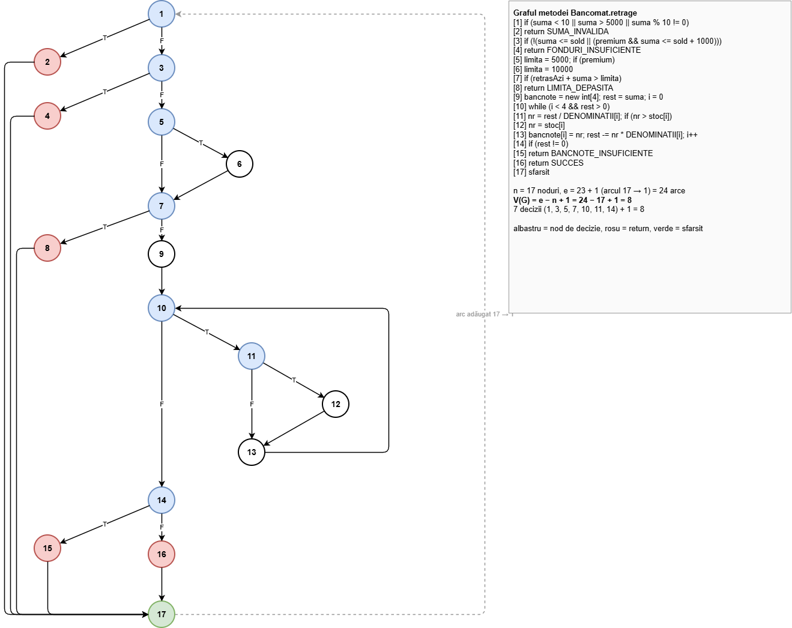
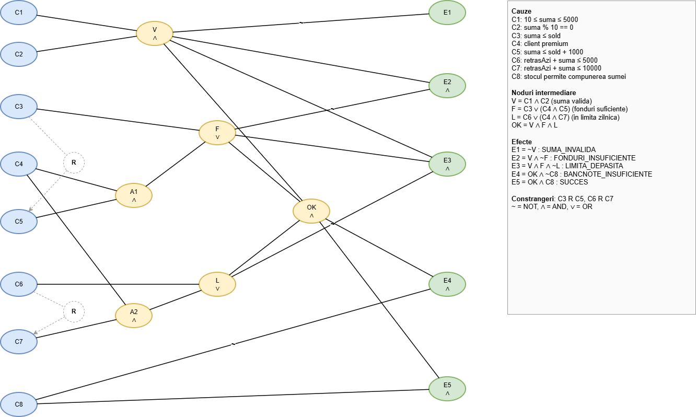

# TSS – Proiect de laborator: Bancomat

Proiect pentru disciplina *Testarea Sistemelor Software*. Metoda testată,
`Bancomat.retrage(suma, sold, retrasAzi, premium, stoc)`, validează o cerere de retragere
(sumă, fonduri, limită zilnică) și alege bancnotele de 200, 100, 50 și 10 lei din stocul
bancomatului. Specificația și rezolvarea cerințelor 1–7 sunt în documentația proiectului:
[docs/Documentatie_TSS.pdf](docs/Documentatie_TSS.pdf).

## Structură

```
src/main/java/ro/tss/bancomat/
    Bancomat.java          metoda testata: retrage(...)
    Rezultat.java, Stare.java
src/test/java/ro/tss/bancomat/
    EchivalentaTest.java   1a  partitionare de echivalenta
    FrontieraTest.java     1b  valori de frontiera
    CauzaEfectTest.java    1c  graf cauza-efect
    MCDCTest.java          4   MC/DC
    mutanti/               5, 6  mutanti scrisi manual + MutantiTest
docs/
    Documentatie_TSS.pdf           documentatia proiectului (cerintele 1-7)
    graf_bancomat.drawio/.png      3   graful orientat al metodei
    graf_cauza_efect.drawio/.png   1c  graful cauza-efect
major/
    bancomat.mml              operatorii Major aplicati metodei retrage
    MajorAnaliza.java         ruleaza testele JUnit 5 pe fiecare mutant Major
    ruleaza_major.sh          genereaza si analizeaza mutantii Major (cerinta 7.2)
rapoarte/
    acoperire/<set>/index.html     rapoarte JaCoCo (cerinta 2)
    pit/<grup>/<set>/index.html    rapoarte PIT (cerinta 7.1)
    major/mutants.log, <set>.csv   rezultate Major (cerinta 7.2)
ruleaza.ps1                       regenereaza rapoartele JaCoCo si PIT
```

## Cum se rulează

Proiectul folosește Java 11+, Maven, JUnit 5, JaCoCo și PIT. Merge cu JDK-ul și Maven-ul
incluse în IntelliJ IDEA: deschide folderul în IntelliJ (*File → Open*), apoi rulează
testele din `src/test/java`.

Regenerarea rapoartelor JaCoCo și PIT, câte un set de teste pe rând (PowerShell):

```powershell
.\ruleaza.ps1                 # acoperire + PIT
.\ruleaza.ps1 -Doar acoperire # doar JaCoCo
.\ruleaza.ps1 -Doar pit       # doar PIT
```

Comenzi Maven individuale:

```
mvn clean test                                   # toate testele
mvn clean test -Dtest=FrontieraTest              # un singur set + raport JaCoCo in target/site/jacoco
mvn clean test-compile org.pitest:pitest-maven:mutationCoverage -DtargetTests=ro.tss.bancomat.MCDCTest
```

### Major

Major 3.0.1 are nevoie de JDK 11. Scriptul le caută implicit în
`%USERPROFILE%\tss-unelte\major` și `%USERPROFILE%\tss-unelte\jdk-11*`. Alte locații se dau
prin variabilele `MAJOR_HOME` și `JAVA11_HOME`. Se rulează din Git Bash, din rădăcina
proiectului:

```
bash major/ruleaza_major.sh
```

## Grafuri

Grafurile sunt realizate în draw.io. Fișierele `.drawio` se deschid cu aplicația desktop sau
cu <https://app.diagrams.net>.




